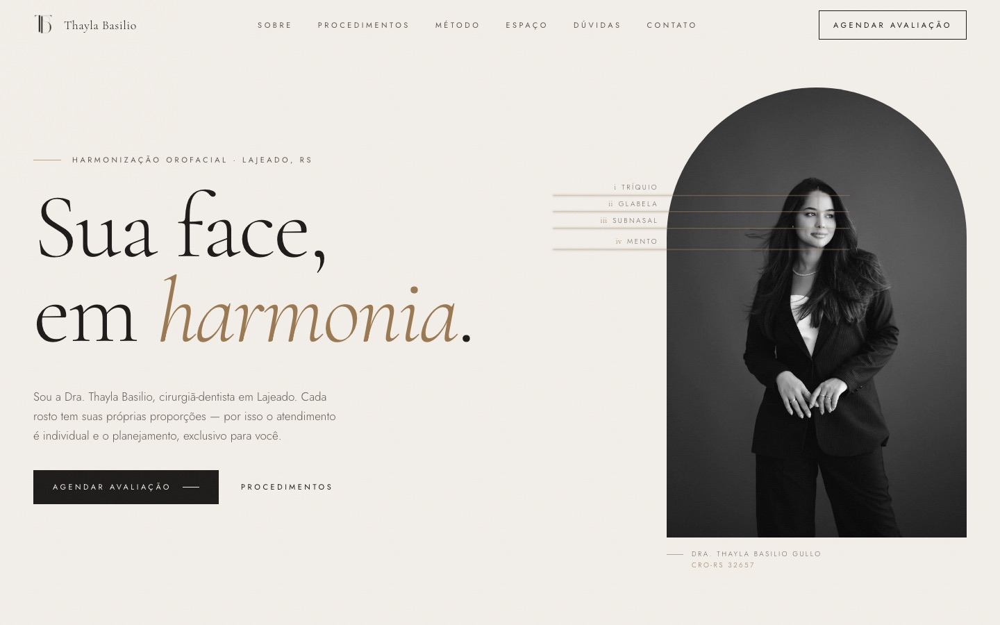

# Dra. Thayla Basilio — site institucional

Site de uma cirurgiã-dentista especializada em harmonização orofacial em Lajeado (RS). Projeto real, feito pela [Averon](https://averon-digital.web.app) e no ar desde 2026.

**No ar:** https://drathaylabasilio.com.br



## O que tem de interessante

- **Mapa do rosto interativo** (`src/components/FaceMap.jsx`): o retrato frontal ganha uma malha de pontos calculada em JS, e cada procedimento acende a região do rosto em que ele atua. Olhos e boca ficam fora da malha.
- **Conteúdo separado do layout**: textos, procedimentos, FAQ e contatos ficam todos em `src/content.js`. Mudar um preço ou uma pergunta não exige mexer em componente.
- **SEO gerado no build**: um plugin do Vite (`seo.config.js`) lê o `content.js` e injeta dados estruturados schema.org (`Dentist`, `FAQPage`) no HTML. O Google entende o consultório sem precisar rodar o JavaScript.
- **Animações com cuidado**: GSAP (ScrollTrigger e SplitText), Lenis e Motion, com respeito ao `prefers-reduced-motion`.
- **Performance**: imagens em WebP e as bibliotecas separadas em chunks próprios, pra continuarem em cache entre um deploy e outro.

## Stack

React 19 · Vite · Tailwind CSS v4 · GSAP · Lenis · Motion · Firebase Hosting

## Rodando local

```bash
npm install
npm run dev
```

Build e deploy: `npm run build && npx firebase-tools deploy --only hosting`.

---

**EN:** Website for an orofacial harmonization dentist in southern Brazil, live at drathaylabasilio.com.br. Built with React, Vite, Tailwind v4 and GSAP. Highlights: an interactive face map that links each procedure to the area of the face it treats, all content kept in a single data file, and schema.org structured data generated at build time.

---

© Pietro Andrade / Averon. Todos os direitos reservados. O código está público apenas como portfólio; não é permitido reutilizá-lo.
